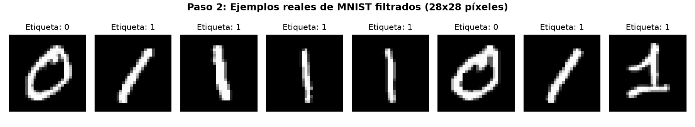
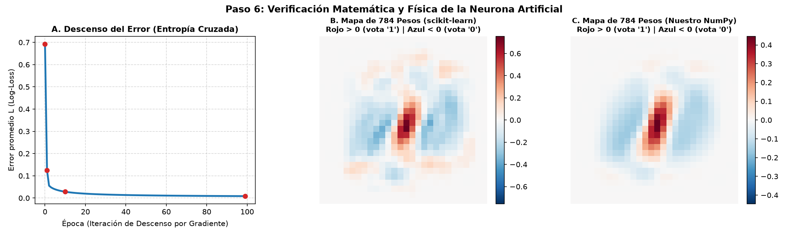
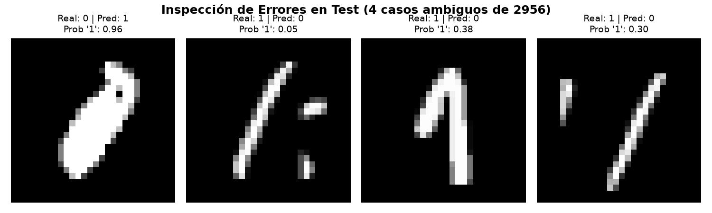

# Proyecto Final de Computación: Red Neuronal para Dígitos (MNIST)
**Entrega 1 — Marco Teórico, Implementación Inicial y Verificación**

---

## 1. El problema: qué es el fenómeno y por qué importa

Reconocer un número escrito a mano es una tarea instantánea para el cerebro humano, pero representa un problema clásico y complejo para la computación tradicional. Mientras que las personas identificamos fácilmente un dígito sin importar si está inclinado, escrito con trazo grueso o desplazado del centro, una computadora solo percibe una cuadrícula de píxeles con valores numéricos de intensidad luminosa. Intentar programar instrucciones fijas (reglas lógicas manuales del tipo `if/else`) para definir qué forma geométrica tiene un `"0"` o un `"1"` fracasa rápidamente debido a la enorme variabilidad de la caligrafía humana.

Para resolver este fenómeno surgió el enfoque del **aprendizaje automático (*Machine Learning*)**: en lugar de programar las reglas de reconocimiento a mano, se formula un modelo matemático capaz de ajustar sus propios parámetros internos a partir de miles de ejemplos. En **1998**, **Yann LeCun, Corinna Cortes y Christopher Burges** publicaron la base de datos **MNIST** (*Modified National Institute of Standards and Technology*), una colección de **70.000 imágenes** de dígitos escritos a mano (de $28 \times 28$ píxeles en escala de grises) por empleados de la Oficina del Censo de Estados Unidos y estudiantes de secundaria.

Este problema importa por dos razones fundamentales:
1. **En el plano práctico e histórico:** dio origen a tecnologías cotidianas de visión por computadora y reconocimiento óptico de caracteres (OCR), como la clasificación automática de sobres por código postal en el correo y la lectura automática de importes en cheques bancarios.
2. **En el plano científico y conceptual:** estudiar cómo una sola neurona artificial (una **regresión logística**) logra distinguir entre dos dígitos a partir de sus píxeles permite desarmar la "caja negra" de la inteligencia artificial, demostrando que el aprendizaje de una máquina se construye íntegramente sobre dos herramientas matemáticas fundamentales: **álgebra lineal** (productos punto) y **cálculo diferencial** (derivadas y regla de la cadena).



---

## 2. La idea de fondo: la matemática detrás de una neurona artificial

En nuestra versión inicial buscamos que el programa decida entre dos dígitos (**`"0"`** vs. **`"1"`**) utilizando una **regresión logística**, que matemáticamente equivale a **una sola neurona artificial**. El modelo opera mediante tres componentes clave: **los pesos y el sesgo**, **la función sigmoide** y **el descenso por gradiente**.

### 2.1. Los píxeles, los pesos ($w_i$) y el sesgo ($b$): una votación ponderada
Cada imagen de MNIST es una cuadrícula de $28 \times 28$ píxeles que se "desenrolla" en un vector fila de $784$ números ($\vec{x} = [x_1, x_2, \dots, x_{784}]$), normalizados de modo que $0.0$ representa un píxel totalmente negro (fondo vacío) y $1.0$ un píxel totalmente blanco (trazo).

Para decidir qué dígito es, la neurona asigna un **peso** ($w_i$) a cada uno de los $784$ píxeles. Cada peso indica cómo influye ese píxel en la decisión:
* **Peso positivo ($w_i > 0$):** si ese píxel está encendido, suma votos a favor de que la imagen sea un **`"1"`** (clase $y = 1$).
* **Peso negativo ($w_i < 0$):** si ese píxel está encendido, resta votos, empujando la decisión hacia el **`"0"`** (clase $y = 0$).
* **Peso cercano a cero ($w_i \approx 0$):** el píxel es irrelevante para distinguir ambos dígitos (por ejemplo, los márgenes exteriores que siempre están negros).

La neurona multiplica cada píxel por su peso, suma todo y añade un umbral base llamado **sesgo** ($b$, o *bias*):

$$z = (w_1 x_1 + w_2 x_2 + \dots + w_{784} x_{784}) + b = \vec{w} \cdot \vec{x} + b$$

---

### 2.2. Ejemplo chico: una mini-imagen de $3 \times 3$ píxeles
Imaginemos que, en lugar de $784$ píxeles, tenemos una pantalla diminuta de $3 \times 3$ ($9$ píxeles) y queremos distinguir un **`"1"`** (un trazo vertical en la columna central) de un **`"0"`** (un anillo con el centro vacío):

```text
   Imagen de un "1"         Imagen de un "0"         Plantilla de Pesos (w)
   [ 0 , 1 , 0 ]            [ 1 , 1 , 1 ]            [ -1 , +2 , -1 ]
   [ 0 , 1 , 0 ]            [ 1 , 0 , 1 ]            [ -1 , +2 , -1 ]
   [ 0 , 1 , 0 ]            [ 1 , 1 , 1 ]            [ -1 , +2 , -1 ]
```

Si la neurona cuenta con la plantilla de pesos $w$ de la derecha (que premia con $+2$ la columna central y castiga con $-1$ las columnas laterales) y un sesgo $b = 0$:

* **Al mostrarle la imagen del `"1"`:** solo están encendidos los $3$ píxeles centrales. Al multiplicar píxel a píxel y sumar:
  $$z = (1 \cdot 2) + (1 \cdot 2) + (1 \cdot 2) = \mathbf{+6}$$
* **Al mostrarle la imagen del `"0"`:** están encendidos los $6$ píxeles laterales (donde $w_i = -1$) y los $2$ extremos superior e inferior del centro (donde $w_i = +2$), mientras que el centro está apagado ($0$):
  $$z = 6 \cdot (-1) + 2 \cdot (+2) = -6 + 4 = \mathbf{-2}$$

---

### 2.3. La función que aplasta entre 0 y 1: la Sigmoide ($\sigma$)
La suma ponderada $z$ puede arrojar cualquier número real entre $-\infty$ y $+\infty$. Como necesitamos que la neurona entregue una **probabilidad** $\hat{y}$ entre $0$ y $1$ (donde $\hat{y} \approx 1$ significa certeza de que es un `"1"`, y $\hat{y} \approx 0$ certeza de que es un `"0"`), pasamos $z$ por la **función sigmoide** (o logística):

$$\hat{y} = \sigma(z) = \frac{1}{1 + e^{-z}}$$

```text
Probabilidad (σ)
  1.0 |                . - - - - - (Si z > 0, se acerca a 1 -> Decide "1")
      |             .
  0.5 | - - - - - * (En z = 0, probabilidad 0.5 -> Indecisión total)
      |         .
  0.0 | _ _ _ .                    (Si z < 0, se acerca a 0 -> Decide "0")
      +----------------------------> z
     -6          0          +6
```

Aplicada a nuestro ejemplo de $3 \times 3$:
* Para la imagen del **`"1"`** ($z = +6$): $\hat{y} = \sigma(6) = \frac{1}{1 + e^{-6}} \approx \mathbf{0.9975}$ ($99.75\%$ de probabilidad de ser un `"1"`).
* Para la imagen del **`"0"`** ($z = -2$): $\hat{y} = \sigma(-2) = \frac{1}{1 + e^{2}} \approx \mathbf{0.1192}$ ($11.92\%$ de probabilidad de ser un `"1"`, por lo que clasifica como **`"0"`**).

---

### 2.4. Definición de la Función de Error (Entropía Cruzada)
En la práctica, los pesos no se escriben a mano: empiezan en $0$ y la neurona los aprende sola midiendo qué tan mal se equivoca. Para cuantificar el error entre la etiqueta real $y \in \{0, 1\}$ y la probabilidad predicha $\hat{y} \in (0, 1)$, utilizamos la **Entropía Cruzada Binaria (*Log-Loss*)**:

* **Si la imagen real es un `"1"` ($y = 1$):** queremos que $\hat{y}$ sea cercano a $1$. Definimos el costo como $-\ln(\hat{y})$. Si acierta con $\hat{y} = 1$, el error es $-\ln(1) = 0$; si falla diciendo $\hat{y} = 0.01$, el error crece a $-\ln(0.01) \approx 4.60$.
* **Si la imagen real es un `"0"` ($y = 0$):** queremos que $\hat{y}$ sea cercano a $0$ (o $1 - \hat{y} \approx 1$). Definimos el costo como $-\ln(1 - \hat{y})$.

Unificando ambos casos en una sola expresión matemática:

$$L(y, \hat{y}) = -\left[ y \cdot \ln(\hat{y}) + (1 - y) \cdot \ln(1 - \hat{y}) \right]$$

*(Cuando $y=1$, el segundo término se anula; cuando $y=0$, se anula el primero).*

---

### 2.5. Obtención del Gradiente paso a paso mediante la Regla de la Cadena
Para saber cómo ajustar cada peso $w_i$ de modo que disminuya el error $L$, debemos hallar la derivada parcial $\frac{\partial L}{\partial w_i}$. Dado que $w_i$ forma parte de $z$, $z$ alimenta a $\hat{y}$, e $\hat{y}$ determina a $L$, tenemos una cadena de funciones compuestas:

$$w_i \longrightarrow z \longrightarrow \hat{y} \longrightarrow L$$

Por la **Regla de la Cadena**, la derivada total es el producto de tres eslabones:

$$\frac{\partial L}{\partial w_i} = \frac{\partial L}{\partial \hat{y}} \cdot \frac{\partial \hat{y}}{\partial z} \cdot \frac{\partial z}{\partial w_i}$$

1. **Primer eslabón $\left(\frac{\partial L}{\partial \hat{y}}\right)$:** Derivando el logaritmo natural respecto a $\hat{y}$ y sacando denominador común:
   $$\frac{\partial L}{\partial \hat{y}} = -\left( \frac{y}{\hat{y}} - \frac{1 - y}{1 - \hat{y}} \right) = -\left( \frac{y(1 - \hat{y}) - \hat{y}(1 - y)}{\hat{y}(1 - \hat{y})} \right) = \frac{\hat{y} - y}{\hat{y}(1 - \hat{y})}$$

2. **Segundo eslabón $\left(\frac{\partial \hat{y}}{\partial z}\right)$:** Derivando la función sigmoide $\hat{y} = (1 + e^{-z})^{-1}$ respecto a $z$:
   $$\frac{\partial \hat{y}}{\partial z} = \frac{e^{-z}}{(1 + e^{-z})^2} = \left(\frac{1}{1 + e^{-z}}\right) \cdot \left(\frac{e^{-z}}{1 + e^{-z}}\right) = \hat{y} \cdot (1 - \hat{y})$$

3. **Tercer eslabón $\left(\frac{\partial z}{\partial w_i}\right)$:** En la suma lineal $z = w_1 x_1 + \dots + w_i x_i + \dots + b$, al derivar respecto a $w_i$ solo sobrevive su coeficiente:
   $$\frac{\partial z}{\partial w_i} = x_i$$

**Multiplicación y cancelación de los tres eslabones:**
$$\frac{\partial L}{\partial w_i} = \underbrace{\left( \frac{\hat{y} - y}{\hat{y}(1 - \hat{y})} \right)}_{\text{Eslabón 1}} \cdot \underbrace{\left( \hat{y}(1 - \hat{y}) \right)}_{\text{Eslabón 2}} \cdot \underbrace{x_i}_{\text{Eslabón 3}} = (\hat{y} - y) \cdot x_i$$

**¿Y cómo se aprende el sesgo ($b$)?**
El sesgo $b$ equivale a un peso multiplicado por una entrada constante igual a $1$ ($z = \sum w_i x_i + b \cdot 1$). Por lo tanto, su tercer eslabón vale $\frac{\partial z}{\partial b} = 1$, y su derivada resulta simplemente:
$$\frac{\partial L}{\partial b} = (\hat{y} - y) \cdot 1 = \hat{y} - y$$

---

### 2.6. Regla de actualización del Descenso por Gradiente y los 4 casos prácticos
Como el gradiente apunta hacia donde el error **crece**, damos un paso en sentido contrario (signo menos) escalado por una **tasa de aprendizaje** $\alpha$ (*learning rate*):

$$w_i^{\text{nuevo}} = w_i^{\text{viejo}} - \alpha \cdot (\hat{y} - y) \cdot x_i$$
$$b^{\text{nuevo}} = b^{\text{viejo}} - \alpha \cdot (\hat{y} - y)$$

Supongamos que fijamos $\alpha = 0.1$ y un píxel tiene inicialmente peso $w_i^{\text{viejo}} = 0.50$. Veamos cómo la fórmula corrige sola en los cuatro escenarios posibles:

1. **Caso 1 — El píxel está apagado ($x_i = 0$):**
   * **Cálculo:** $\text{Gradiente} = (\hat{y} - y) \cdot 0 = 0 \implies w_i^{\text{nuevo}} = 0.50 - 0 = \mathbf{0.50}$.
   * **Lógica:** Como el píxel valía $0$, no aportó nada a la suma $z$. No tuvo responsabilidad en el error y su peso queda intacto.
2. **Caso 2 — La neurona acierta sin dudar ($\hat{y} = y$):**
   * **Cálculo:** $\text{Gradiente} = (1 - 1) \cdot 1 = 0 \implies w_i^{\text{nuevo}} = 0.50 - 0 = \mathbf{0.50}$.
   * **Lógica:** Si no hay error ($\hat{y} - y = 0$), el peso no se altera.
3. **Caso 3 — Era un `"1"` ($y = 1$), pero la neurona predijo bajo ($\hat{y} = 0.20$) con píxel encendido ($x_i = 1$):**
   * **Cálculo:** $\text{Gradiente} = (0.20 - 1) \cdot 1 = -0.80 \implies w_i^{\text{nuevo}} = 0.50 - 0.1 \cdot (-0.80) = 0.50 + 0.08 = \mathbf{0.58}$.
   * **Lógica:** *Menos por menos da más*. Como la neurona se quedó corta para detectar al `"1"`, la fórmula **sube el peso** de ese píxel.
4. **Caso 4 — Era un `"0"` ($y = 0$), pero la neurona creyó que era un `"1"` ($\hat{y} = 0.90$) con píxel encendido ($x_i = 1$):**
   * **Cálculo:** $\text{Gradiente} = (0.90 - 0) \cdot 1 = +0.90 \implies w_i^{\text{nuevo}} = 0.50 - 0.1 \cdot (+0.90) = 0.50 - 0.09 = \mathbf{0.41}$.
   * **Lógica:** Como se pasó de largo cuando en realidad era un `"0"`, la fórmula **baja el peso** de ese píxel, empujándolo hacia valores negativos.

---

## 3. Las bibliotecas: cuáles usamos y qué hacen sus partes clave

Para construir y verificar el programa utilizamos tres bibliotecas estándar del ecosistema científico de Python:

| Biblioteca y Módulo | Componente / Función Clave | Qué hace exactamente en nuestro programa |
| :--- | :--- | :--- |
| **`scikit-learn`** (`sklearn.datasets`) | `fetch_openml('mnist_784')` | Descarga las $70.000$ imágenes de MNIST en una matriz `X` de $(70000, 784)$ y un vector de etiquetas `y`. |
| **`scikit-learn`** (`sklearn.model_selection`) | `train_test_split(..., stratify=y)` | Separa el $80\%$ de las imágenes para entrenar (`X_train`) y reserva el $20\%$ para evaluar (`X_test`), manteniendo la proporción exacta de `'0'`s y `'1'`s. |
| **`scikit-learn`** (`sklearn.linear_model`) | `SGDClassifier(loss='log_loss')` | Implementa la neurona con función de pérdida de Entropía Cruzada (`log_loss`, sigmoide) entrenada por Descenso por Gradiente. |
| **`scikit-learn`** (Atributos internos) | `.coef_`, `.intercept_`, `.predict_proba()` | `.coef_` guarda los $784$ pesos aprendidos ($\vec{w}$); `.intercept_` guarda el sesgo ($b$); `.predict_proba()` calcula $\sigma(\vec{w}\cdot\vec{x}+b)$. |
| **`NumPy`** (`numpy`) | `np.dot()`, `np.exp()`, `X / 255.0`, `.reshape(28, 28)` | Filtra los dígitos `'0'` y `'1'`, normaliza los píxeles al rango $[0, 1]$, ejecuta los productos punto matriciales y reconstruye vectores de $784$ en matrices de $28 \times 28$. |
| **`Matplotlib`** (`matplotlib.pyplot`) | `plt.imshow(..., cmap='RdBu_r')` | Dibuja los dígitos en escala de grises y genera el mapa de calor de los $784$ pesos para inspeccionar visualmente qué aprendió la neurona. |

---

## 4. La verificación: pruebas de control y resultados obtenidos

Para comprobar científicamente que el programa funciona como debe, diseñamos y ejecutamos cuatro verificaciones sobre el conjunto de prueba (**$2.956$ imágenes de `'0'` y `'1'` que la neurona nunca vio durante el entrenamiento**):

### 4.1. Verificación de la cuenta interna (Caja Transparente)
En la primera imagen de prueba (`X_test[0]`, etiqueta real $y = 1$), calculamos manualmente el producto punto $z = \vec{w} \cdot \vec{x} + b = 9.0770$ y la función sigmoide $\sigma(9.0770)$, obteniendo **`0.99988575`**, exactamente el mismo valor hasta el octavo decimal que devuelve `neurona.predict_proba()`. Asimismo, ante una **imagen sintética totalmente negra** ($\vec{x} = \vec{0}$), verificamos que la salida del modelo coincide exactamente con el valor teórico conocido $\sigma(b) = \frac{1}{1 + e^{-0.5317}} = \mathbf{0.62987174}$.

### 4.2. Propiedad matemática: Descenso monótono del error
Al entrenar nuestra propia neurona en NumPy desde pesos en cero ($\vec{w} = \vec{0}, b = 0$), verificamos que en la **Época 0** el error inicial es exactamente $-\ln(0.5) = \mathbf{0.6931}$ con una exactitud de **`53.30%`** (azar puro). A medida que avanza el descenso por gradiente, el error decrece monótonamente época tras época (`0.6931 -> 0.1248 -> 0.0392 -> 0.0174 -> 0.0086`), convergiendo sin oscilaciones.

### 4.3. Inspección física de resultado conocido: El Mapa de Pesos ($28 \times 28$)
Al reacomodar los $784$ pesos aprendidos en una grilla de $28 \times 28$ píxeles (`paso6_verificacion_modelo.png`, paneles B y C), se comprueba visualmente la estructura física esperada:
* En el **centro vertical** aparecen pesos **fuertemente positivos (rojo)**, que detectan el bastón vertical del **`"1"`**.
* Alrededor del centro se forma un **anillo de pesos negativos (azul)**, que detectan el contorno circular del **`"0"`**.
* Los **bordes exteriores** permanecen en **blanco ($w_i = 0$)** porque esos píxeles están apagados en todas las imágenes ($x_i = 0$).



### 4.4. Comparación con valores publicados
De acuerdo con la literatura (LeCun et al., 1998; Géron, 2022), un clasificador lineal binario entre `'0'` y `'1'` en MNIST debe superar el **$99\%$ de exactitud**. En nuestro experimento sobre las $2.956$ imágenes de prueba obtuvimos:
* **Exactitud con `scikit-learn` (`SGDClassifier`):** **`99.86%`** ($2.952$ aciertos y solo **$4$ errores** en $2.956$ imágenes: $1.380/1.381$ ceros correctos y $1.572/1.575$ unos correctos).
* **Exactitud con nuestra neurona de 10 líneas en `NumPy`:** **`99.73%`**.

Al inspeccionar visualmente los únicos $4$ errores del examen (`paso6_errores_test.png`), observamos que corresponden a caligrafías extremas (un `'0'` pintado totalmente relleno en el centro sin agujero, y tres `'1'`s con trazos laterales anómalos).



---

## 5. Las fuentes: bibliografía citada

1. **LeCun, Y., Bottou, L., Bengio, Y., & Haffner, P. (1998).** *Gradient-based learning applied to document recognition*. Proceedings of the IEEE, 86(11), 2278–2324. https://doi.org/10.1109/5.726791
   * *Aporte:* Artículo fundacional de MNIST; provee el contexto histórico (lectura de cheques y códigos postales) y los valores de referencia (*benchmarks*, Tabla I) para clasificadores lineales de una capa.
2. **LeCun, Y., Cortes, C., & Burges, C. J. (1998).** *The MNIST Database of Handwritten Digits*. Courant Institute of Mathematical Sciences, New York University. https://yann.lecun.com/exdb/mnist/
   * *Aporte:* Especificación técnica de las $70.000$ imágenes normalizadas a $28 \times 28$ píxeles en escala de grises ($0$ a $255$).
3. **Nielsen, M. A. (2015).** *Neural Networks and Deep Learning*. Determination Press. Capítulos 1 y 3. http://neuralnetworksanddeeplearning.com/
   * *Aporte:* Deducción pedagógica y matemática de la neurona sigmoide (Cap. 1) y demostración de la cancelación de $\hat{y}(1-\hat{y})$ en la regla de la cadena al derivar la función de costo de entropía cruzada para obtener $\frac{\partial L}{\partial w_i} = (\hat{y} - y)x_i$ y $\frac{\partial L}{\partial b} = \hat{y} - y$ (Cap. 3).
4. **Bishop, C. M. (2006).** *Pattern Recognition and Machine Learning*. Springer. Capítulo 4, Sección 4.3.2 (*Logistic Regression*, págs. 205–207).
   * *Aporte:* Fundamentación formal de la regresión logística binaria, derivada de la función logística $\sigma'(z) = \sigma(z)(1-\sigma(z))$ y optimización por gradiente.
5. **Géron, A. (2022).** *Hands-On Machine Learning with Scikit-Learn, Keras, and TensorFlow* (3.ª ed.). O'Reilly Media. Capítulos 3 y 4.
   * *Aporte:* Uso práctico de `fetch_openml('mnist_784')`, entrenamiento de clasificadores binarios con `SGDClassifier` y métricas de evaluación en MNIST.
6. **Pedregosa, F., Varoquaux, G., Gramfort, A., et al. (2011).** *Scikit-learn: Machine Learning in Python*. Journal of Machine Learning Research, 12, 2825–2830. Documentación oficial: https://scikit-learn.org/stable/modules/sgd.html y https://scikit-learn.org/stable/modules/linear_model.html#logistic-regression
   * *Aporte:* Especificación de `SGDClassifier(loss='log_loss')`, atributos `.coef_` ($\vec{w}$), `.intercept_` ($b$) y `.predict_proba()`.
7. **Harris, C. R., Millman, K. J., van der Walt, S. J., et al. (2020).** *Array programming with NumPy*. Nature, 585(7825), 357–362. https://doi.org/10.1038/s41586-020-2649-2
   * *Aporte:* Operaciones vectorizadas sobre arreglos multidimensionales (`ndarray`), producto punto `np.dot` y redimensionamiento `.reshape(28, 28)`.
8. **Hunter, J. D. (2007).** *Matplotlib: A 2D graphics environment*. Computing in Science & Engineering, 9(3), 90–95. https://doi.org/10.1109/MCSE.2007.55
   * *Aporte:* Visualización de matrices de píxeles y mapas de calor divergentes (`imshow` con `cmap='RdBu_r'`) para la inspección del vector de pesos.
